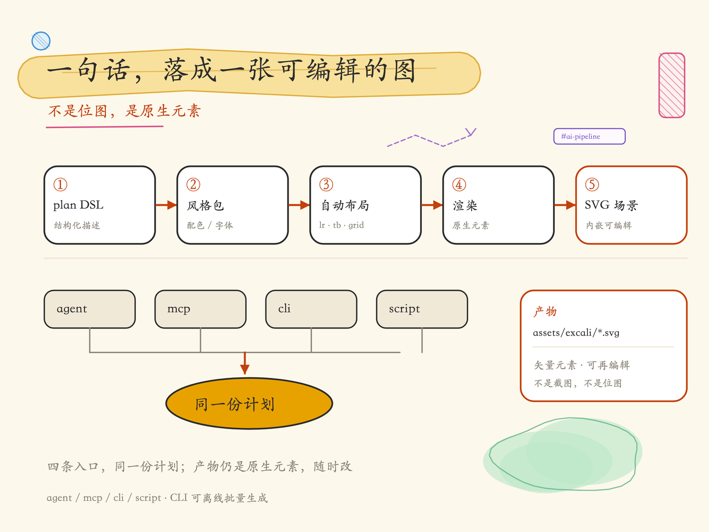

# Excali 白板

**在思源笔记里，把想法画成一张随时能改、能放映、能放进文档的图。**

Excali 白板（`siyuan-excali-studio`）把 [Excalidraw](https://excalidraw.com/) 装进思源的**原生页签**——不是 iframe、不是弹层。它保存的 SVG **内嵌完整可编辑场景**：既是正文里能直接看的图，也是能再次打开的工程图，与 excalidraw.com、集市 `siyuan-embed-excalidraw` 存的老图互认。

> [!NOTE]
> 一张白板就是工作空间里的一份 SVG 文件。改一次，文档里的图跟着更新；再打开它，每个元素都还能单独拖动、改色、改字。**不是截图，不是位图。**

## 一张画布，四件事

| 你想做的事 | Excali 白板怎么做 |
|---|---|
| 随手画 | 原生 Excalidraw 画布，16 款中英文字体，跟随思源明暗主题 |
| 讲给人听 | 画布上的画框直接当幻灯片放映，不用另存 PPT |
| 让 AI 画 | 一句话 → 结构化管线 → 原生矢量元素，产物仍可编辑 |
| 写进文档 | 复制引用粘进正文，点一下回到画布继续画 |

### 一、画框，就是幻灯片


不用导出、不用切软件：在画布上框一块内容，就是一个画框，也就是一页。

- 页序默认按阅读顺序（先上后下、同行先左后右）；画了箭头就**按箭头走**，能分叉、能绕回
- 每页可选「整页一起出」或「逐条出场」，配幕布、打字机、镜头留白、自动前进、全屏
- 改完内容，放映里立刻生效——**画完就能放，改完还能放**

### 二、一句话，落成一张可编辑的图



AI 不是往画布里塞一张位图，而是走一条确定性管线：**plan DSL → 风格包 → 自动布局 → 渲染 → 内嵌场景的 SVG**。产物是原生元素，随时能改。

- 四条入口：思源内置智能体 `excali_*` / 内核 MCP / 无头 CLI / `ea.*` 脚本，四条入口共用同一份计划
- 外部风格包 `data/assets/excali-styles/*.json`（diff-only 继承），内置 pencil / marker / blueprint 三预设
- CLI 可离线批量生成，同一套风格与布局可复用于不同主题
- 素材库：官方组件面板 + 自建组件本地持久化 + 磁盘变更热刷新

### 三、画完就进文档，点开还能继续画


☰ 菜单「**复制此白板的引用**」把 `` 放进剪贴板，粘到思源正文里就是一块白板图片。插件会给它加上 `Excali` 徽标和「用 Excali 白板打开 ↗」，点一下回到可编辑画布。

- 导出 PNG / JPEG / WebP / SVG，支持 1–3 倍缩放、透明底、仅导出选中、下载或复制到剪贴板；SVG 可勾选内嵌可编辑场景
- 数据源仍是那一份 SVG，改一次，文档里同步更新
- 图片拖放入画布、剪贴板粘贴；文档里的白板嵌入图点击即开；移动端（iPad / 手机）用全屏浮层承载同一套画板

## 能力一览

| 分组 | 能力 |
|---|---|
| 白板核心 | 三个入口（dock 白板库 / 顶栏图标 / 文档右键「最近打开」）、新建即命名、停笔约 1 秒防抖自动保存、`⌘/Ctrl+S` 强存、关页签自动冲刷、保存位置可自定义、页签缩略图与布局记忆 |
| 画布与兼容 | Excalidraw 0.18.1 原生集成、跟随明暗主题、16 款中英文字体（小赖体 / 霞鹜文楷 / 得意黑等）、直接打开 Obsidian Excalidraw 文件（1v1 / 1v2 payload，压缩与空场景容错）、Notion 式文本折叠列表 |
| 演示 | 画框即页、按箭头走、逐条出场、幕布 / 打字机 / 镜头留白 / 自动前进 / 全屏 |
| AI 绘图 | plan DSL 五步管线、agent / mcp / cli / script 四通道、外部风格包、素材库 |
| 脚本引擎 | `data/assets/excali-scripts/*.md`，`ea` API v1（55+ 方法）；文件头写 `@excalidraw-onload` 的脚本在画布就绪时自动运行 |
| 导出与联动 | PNG / JPEG / WebP / SVG、复制到剪贴板、复制白板引用、文档内白板块点击即开、移动端一致体验 |

## 快速开始

1. 思源集市搜索「Excali 白板」安装；或从 [Release](https://github.com/LongDarkroom/siyuan-excali-studio/releases) 下载 `package.zip`，在「设置 → 集市 → 已下载」中导入
2. 点顶栏白板图标，或在 dock 白板库点「+」，起个名字就开始画，即写即存
3. 想让 AI 画：对思源内置智能体说「帮我画一张 XX 思维导图」；或用 CLI 离线批量生成：

```bash
# Node 22.6+；--workspace 指向含 data/ 的思源工作空间
node scripts/excali-board.mjs list   --workspace /path/to/思源工作空间 --list-styles
node scripts/excali-board.mjs create --workspace /path/to/思源工作空间 --plan plan.json --title 名称 --style 包名
node scripts/excali-board.mjs append --workspace /path/to/思源工作空间 --board 标题 --plan plan.json
```

## 社区与反馈

使用问题与功能建议，欢迎来这里交流。

| 渠道 | 地址 |
|---|---|
| B 站 | [微光突围](https://space.bilibili.com/39780528) |
| QQ 群 | **123795105** |

## 数据与保存

- **保存即文件**：每张白板是 `data/assets/excali/` 下的一份 SVG 文件（内嵌场景），重命名、同步、备份都走普通文件
- **一块板一个文件**：不再写 `.bak` 备份档；落盘前有「正文逐字 + 载荷语义」两道等价门，打开没动、只是 vendor 归一化或换主题背景造成的差异不会重写文件。误删／写坏靠思源自身的数据历史兜底；老用户库里的存量 `.bak*` 仍被列表排除、被重命名／删除带走，解码失败页的「从备份恢复」也照常能用
- **与生态互认**：与 excalidraw.com、集市 `siyuan-embed-excalidraw` 存的老图互相打开
- 开发细节与发版验收清单见仓库 [docs/](https://github.com/LongDarkroom/siyuan-excali-studio/tree/main/docs) 目录

## 字体授权与致谢

本插件打包分发以下字体文件（`fonts/` 目录），均为 SIL Open Font License 1.1 或等效免费商用授权，允许随本软件捆绑再分发（依据 OFL 1.1，不得单独售卖字体文件本身）：

| 字体 | 用途 | 授权 / 来源 |
|---|---|---|
| Virgil / Excalifont | Excalidraw 手写体 | Excalidraw 项目（MIT） |
| Cascadia / Liberation Sans / Assistant / Nunito / Lilita One | 拉丁 UI 字体 | SIL OFL 1.1 |
| Xiaolai 小赖体 | 中文手写体 | SIL OFL 1.1 · [lxgw/kose-font](https://github.com/lxgw/kose-font) |
| LXGW WenKai Lite 霞鹜文楷 | 中文正文 | SIL OFL 1.1 · [lxgw/LxgwWenKai](https://github.com/lxgw/LxgwWenKai) |
| Smiley Sans 得意黑 | 中文展示体 | SIL OFL 1.1 · [atelier-anchor/smiley-sans](https://github.com/atelier-anchor/smiley-sans) |
| Caveat / Yusei Magic / Zen Kurenaido / Patrick Hand | 拉丁手写装饰 | SIL OFL 1.1 |
| Comic Shanns | 拉丁手写体 | MIT · [shannpersand/comic-shanns](https://github.com/shannpersand/comic-shanns) |

Canvas 内核为 [Excalidraw](https://github.com/excalidraw/excalidraw)（MIT），本插件含其定制构建产物 `engine.js`（含中文文案补丁与扩展字体注册）。

逐族版权声明与许可证全文见 `fonts/COPYRIGHTS.md`（随发布包分发，满足 OFL 1.1 第 2 条「每份副本须含版权声明与许可证」）。

## 开源许可

本插件源码直接使用 **AGPL-3.0-or-later**（GNU Affero General Public License v3.0 或任何更新版本），`Copyright (C) 2026 LongDarkroom`，许可证全文见仓库 `LICENSE`。

随包分发的第三方组件（Excalidraw、字体等）按各自许可证授权，声明与全文见 `THIRD-PARTY-NOTICES.md`、`fonts/COPYRIGHTS.md`。
